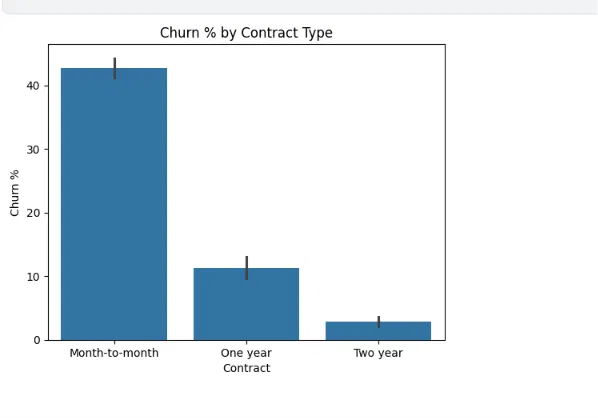
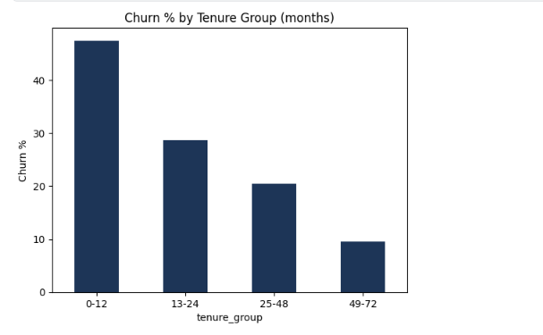
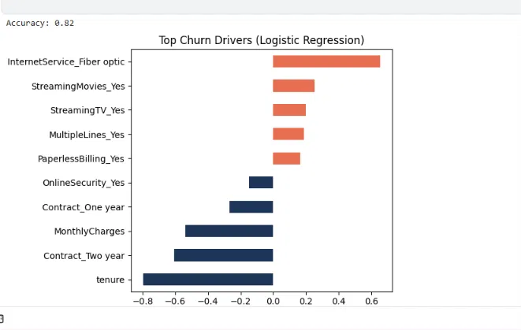

# Telco Customer Churn Analysis

**Tools:** Python, Pandas, Seaborn, SciPy, scikit-learn

## Business question
Which customers leave, what is linked to it, and where should the company focus to reduce churn?

## Dataset
IBM Telco Customer Churn (Kaggle): 7,043 customers, 21 columns. Target: `Churn` (Yes/No).

## Data cleaning
- `TotalCharges` was stored as text; converted to numeric.
- 11 blank `TotalCharges` values belonged to new customers (tenure = 0), so they were set to 0.
- No duplicate rows. `Churn` converted to a 1/0 flag.

## Key findings
- Overall churn rate: **26.54%** (1,869 of 7,043 customers).
- Churn is highest early: **47.4%** in the first 12 months vs **9.5%** for 49-72 months.
- By contract: month-to-month **42.7%**, one year **11.3%**, two year **2.8%**.
- By internet service: fiber optic **41.9%**, DSL 19.0%, no internet 7.4%.
- By payment method: electronic check **45.3%**, versus 15.2% to 19.1% for other methods.
- Chi-square tests (Contract, InternetService, PaymentMethod, PaperlessBilling): all p < 0.05.
- T-test: churned customers paid more per month (74.44 vs 61.27, p < 0.05).
- Logistic regression (accuracy 0.82): tenure and longer contracts are linked to lower churn; fiber optic, streaming services and paperless billing are linked to higher churn.
- **High-risk segment** (month-to-month, tenure up to 12 months): 1,994 customers, 51.4% churn, accounting for 54.8% of all churned customers.

## Recommendations
1. Strengthen onboarding in the first 12 months (welcome offer, follow-up call).
2. Offer discounts to move month-to-month customers to 1 or 2 year contracts.
3. Review fiber optic service quality and pricing.
4. Encourage automatic payment methods over electronic check.
5. Bundle services such as Online Security, which is linked to lower churn.

## Charts

## Notes
Statistical tests and regression show association, not proven cause.
